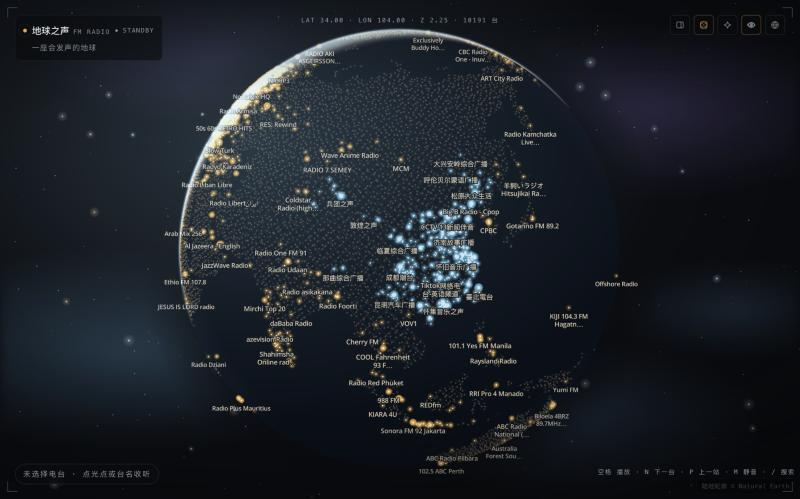
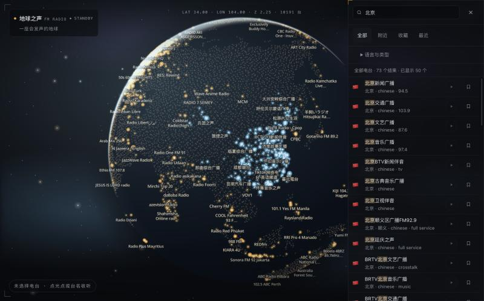
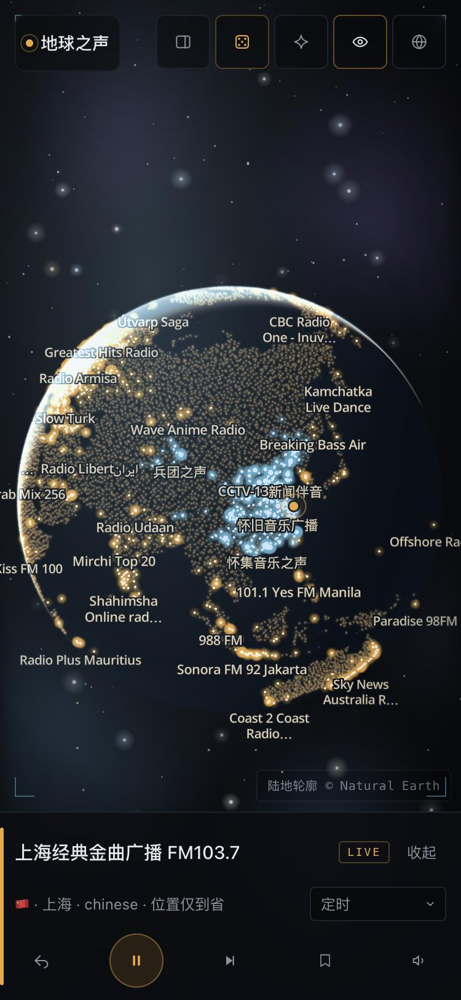
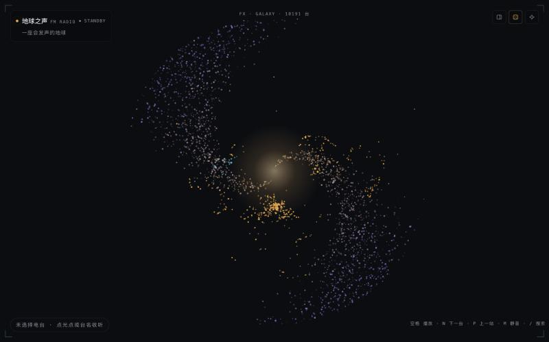
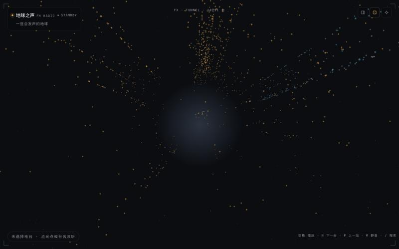
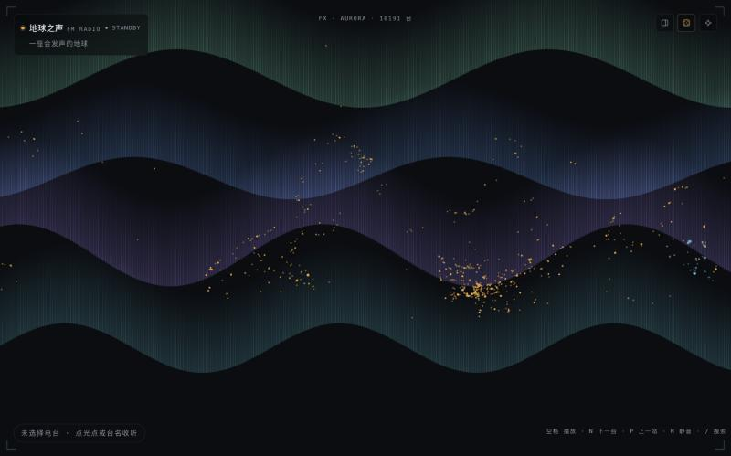

# 地球之声 · FM Radio

一个纯前端的全球电台地图：转动地球，点一个光点，听那个地方此刻正在说的话。

- 10,000+ 个电台落在球面上；中国台按台名推断到城市，并标注估算
- 搜索台名、省份、城市或国家，按语言与类型筛选
- 收藏、最近收听、附近电台、随机探索、返回上一站
- 睡眠定时、分享深链、Media Session 锁屏控制
- 银河 / 星流 / 极光三种粒子特效壁纸

没有账号、没有后端；收藏与收听记录只保存在本机。

## 界面



| 搜索与筛选 | 手机收听 |
| :---: | :---: |
|  |  |

> 截图来自当前开发版本；标签密度与推荐结果会随电台快照变化。

### 粒子特效

| 银河 | 星流 | 极光 |
| :---: | :---: | :---: |
|  |  |  |

## 技术栈

React 19 · Vite · TypeScript · Zustand · MapLibre GL · hls.js · Tailwind CSS 4

## 快速开始

```bash
pnpm install
pnpm dev
```

打开 http://localhost:5555 。

要求 Node.js >= 22.6（测试依赖 `--experimental-strip-types`）与 pnpm 12；当前固定在 24，见 `.node-version` / `package.json`。

## 常用命令

| 命令 | 作用 |
| --- | --- |
| `pnpm dev` | 本地开发服务器 |
| `pnpm build` | 类型检查 + 生产构建 |
| `pnpm preview` | 预览构建产物 |
| `pnpm typecheck` | 只跑 TypeScript |
| `pnpm test` | Node 测试（纯逻辑，不联网） |
| `pnpm e2e` | Playwright 冒烟（首次需安装 Chromium，见下） |
| `pnpm data:pull` | 按 manifest 拉取并校验电台快照 |
| `pnpm data:release` | 拉取 radio-browser 全量并重建快照，然后构建 |
| `pnpm data:publish` | 把当前快照发布到 GitHub Release，更新 manifest |
| `pnpm data:validate` | 校验本地三份快照的结构，不联网 |
| `pnpm data:check` | 抽查热门流是否还能连上，需要外网 |

`scripts/` 下另有地图底图、中国地名等构建脚本，只在数据更新时手动使用。

## 数据

电台目录来自 [radio-browser](https://www.radio-browser.info/)，在构建期生成三份快照，前端用 `?url` 引入并配合内容哈希缓存：

| 分片 | 内容 | 加载时机 |
| --- | --- | --- |
| `core` | 中国全部 + 境外点击量前 1000 | 首屏，地图就绪前 |
| `rest` | 其余有坐标的境外台 | 地图就绪后空闲加载 |
| `catalog` | 无坐标、可播但无法上图 | 搜索词达到 2 个字或开始筛选时 |

快照不再进 git 历史，而是发布成 GitHub Release；仓库里只跟踪 [`data/manifest.json`](data/manifest.json)（tag、文件大小与 sha256）。`pnpm dev` / `pnpm build` 前会自动执行 `fetch-data --if-missing`，首次克隆会拉取一次并校验；也可以手动执行：

```bash
pnpm data:pull
```

周更流程：

```bash
pnpm data:release     # 拉全量 + 校验 + 构建；失败不会写入任何文件
pnpm data:publish     # 创建数据 release，更新 manifest（--dry-run 只写 manifest）
pnpm data:check       # 抽查热门流
pnpm data:validate    # 复查快照结构
```

构建脚本会在写盘前检查分片结构、跨片重复和数量骤降（低于上一版 85% 直接失败）；确认数据确实变少时用 `node scripts/build-stations.mjs --force`。发布后记得提交更新过的 `data/manifest.json`，否则 CI 会按旧哈希拉取。

`pnpm data:publish` 优先使用 `gh` CLI；没有安装 gh 时，设置 `GITHUB_TOKEN`（需要 contents 读写权限）会改走 GitHub REST API 上传。

## 目录

```
src/
  components/   页面外壳、抽屉、播放条、引导等
  pages/        路由页面
  map/          MapLibre 地球、命中测试、底图
  fx/           粒子特效场景与注册表
  player/       播放引擎、错误分类、Media Session
  store/        zustand：播放、地图、特效、收藏
  lib/          纯逻辑（搜索、发现、存储、定位、手势…）
  data/         构建期生成的电台快照
scripts/        数据管线与地图底图生成
tests/          Node 测试
```

更细的模块关系与数据流见 [docs/architecture.md](docs/architecture.md)。

## 测试与 CI

`pnpm test` 覆盖 118 个纯逻辑用例；`pnpm e2e` 是 Playwright 冒烟，覆盖首屏、搜索、点台、深链和抽屉五条路径。本地首次运行前需要下载 Chromium：

```bash
pnpm exec playwright install chromium
```

`.github/workflows/ci.yml` 在 push / PR 时依次跑 `typecheck`、`data:validate`、`test`、`build`，之后单独跑 e2e。`data:check` 不在 CI 里运行——它会访问真实流地址，适合周更时手动执行。

## 部署

静态站点，构建产物在 `dist/`。分享卡片需要绝对地址时，在 `.env.local` 里设置：

```bash
VITE_SITE_URL=https://your-domain.example
```

留空也能正常运行，只是 `og:url` / `og:image` 会退化为相对路径。示例见 `.env.example`。

如果托管站点要求 sharecode 才能访问（WorkBuddy 就是如此，裸域名和 `og.png` 都会 403），再补一行：

```bash
VITE_SHARE_QUERY=sharecode=XXXXXXXX
```

它会附加到 `og:url` / `canonical` 与 `og:image` 后面，保证爬虫能抓到页面和图片。

## 说明

- 流地址由第三方提供，只收 https；部分台随时可能停播。
- 定位使用浏览器 Geolocation，坐标只在内存中参与距离计算，不上传、不持久化。
- 移动端真机（软键盘、锁屏、后台播放）尚未完成全面验收。
